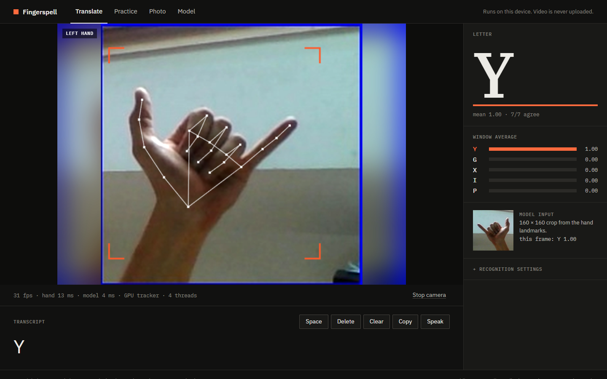
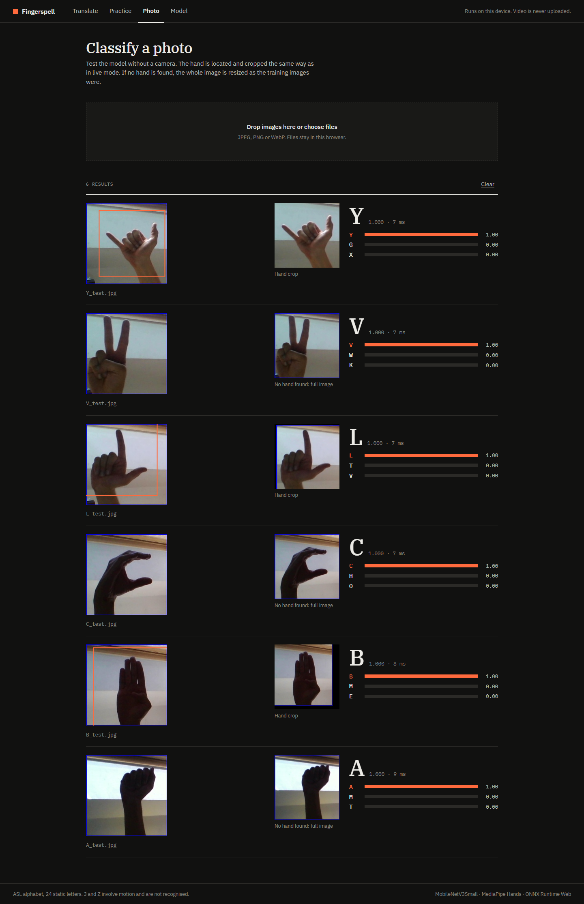
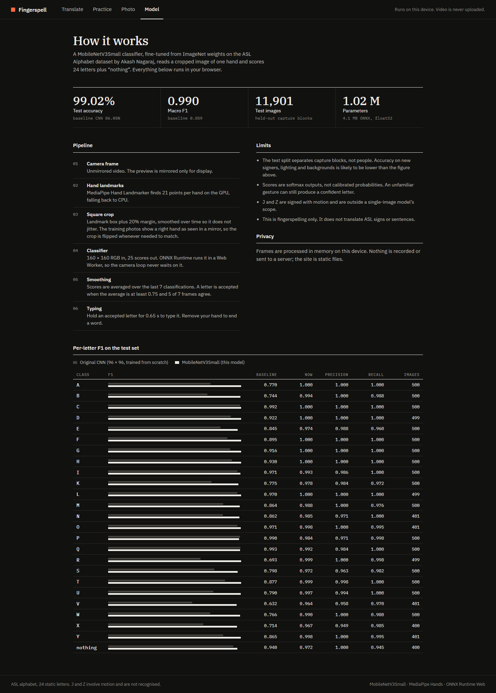

# Static ASL Fingerspelling Recognition

Real-time recognition of the 24 static American Sign Language (ASL) alphabet
letters from an ordinary webcam. MediaPipe finds the hand, a MobileNetV3-Small
CNN (transfer learning from ImageNet) classifies the hand crop, and a vote over
recent frames keeps the output steady. The same model runs in a Python webcam
demo and in a browser app that does all processing on the user's device.

| Team member | Section | Roll No. |
|---|---|---|
| Sarvesh Bhanarkar | C | 56 |
| Prashant Malani | C | 53 |
| Aaditya Hajari | C | 43 |
| Mayank Thakur | C | 52 |

**Scope.** 24 static letters plus a `nothing` class. J and Z are signed with
motion, so a single-image model cannot recognize them. The project does not
translate words or sentences, and it does not cover Indian Sign Language.

## Results at a glance

Both models were trained on the same data split and tested on the same 11,901
held-out images.

| Measure | Baseline CNN (from scratch) | **MobileNetV3-Small (final)** |
|---|---:|---:|
| Test accuracy | 86.05% | **99.02%** |
| Macro-F1 | 0.859 | **0.990** |
| Misclassified test images | 1,660 | **117** |
| Input size | 96 × 96 | 160 × 160 |
| Parameters | 1,206,585 | 1,016,201 |
| Training time (Kaggle T4) | 169 s | 1,425 s |
| Model-only latency, median | 0.94 ms | 5.24 ms |

The test images come from the same recording setup as the training images, so
these numbers are **not** accuracy on new signers. See [RESULTS.md](RESULTS.md)
for the full comparison.

---

## Contents

1. [Sample output](#1-sample-output)
2. [Repository structure](#2-repository-structure)
3. [Dataset](#3-dataset)
4. [Model weights](#4-model-weights)
5. [How to run](#5-how-to-run)
6. [Method](#6-method)
7. [Limitations](#7-limitations)
8. [References](#8-references)

---

## 1. Sample output

**Live camera (web app, Translate page).** The tracked hand, the crop sent to
the model, the accepted letter, and the averaged scores of the top five classes.
The status line shows 31 fps, 13 ms hand tracking and 4 ms classification per
frame on our laptop.



**Photo upload (web app, Photo page).** Each uploaded image with its hand crop
and the top three predictions.



**Model page (web app).** Test metrics and per-class scores, served with the model.



**Training curves and confusion matrix** (from `model_results/`):

| Learning curves | Confusion matrix (test set) |
|---|---|
|  |  |

More outputs are saved in `model_results/`: `class_examples.png` (one training
image per class) and `error_examples.png` (misclassified test images).

---

## 2. Repository structure

```
.
├── Static_ASL_Training.ipynb      # Training notebook for the final model (run on Kaggle)
├── Static_ASL_Executed.ipynb      # Same notebook with all outputs, as executed
├── webcam.py                      # Python webcam demo (MediaPipe + Keras model + voting)
├── temporal_vote.py               # Majority vote over recent frames, used by webcam.py
├── requirements_webcam.txt        # Python dependencies for the webcam demo
├── run.bat                        # Windows shortcut: activate .venv and start the demo
│
├── model_results/                 # Final model (MobileNetV3-Small) and its evaluation
│   ├── best_model.keras           #   trained weights (4.5 MB)
│   ├── inference_config.json      #   class order, input size, voting settings
│   ├── metrics.json               #   test accuracy, macro-F1, latency
│   ├── classification_report.csv  #   per-class precision / recall / F1
│   ├── confusion_matrix.png, learning_curves.png, error_examples.png, ...
│   ├── split_manifest.csv         #   which image is in train / val / test
│   └── history.csv, model_summary.txt, training_environment.txt, ...
│
├── baseline/                      # Baseline CNN trained from scratch, for comparison
│   ├── Original_CNN_Training.ipynb, Original_CNN_Executed.ipynb
│   ├── best_model.keras           #   baseline weights (14 MB)
│   └── metrics.json, classification_report.csv, confusion_matrix.png, ...
│
├── tools/
│   └── export_web_model.py        # Converts best_model.keras to ONNX for the web app
│
├── web/                           # Browser app (React + TypeScript + Vite)
│   ├── public/model/model.onnx    #   the final model in ONNX format (4 MB)
│   ├── public/mediapipe/          #   MediaPipe hand landmarker model
│   └── src/
│       ├── views/                 #   Translate, Practice, Photo and Model pages
│       ├── components/            #   camera stage, readout, settings panel
│       └── lib/                   #   hand tracking, cropping, classifier worker,
│                                  #   smoothing/voting, typing logic, unit tests
├── screenshots/                   # Sample output used in this README
├── RESULTS.md                     # Baseline vs. final model comparison
└── vercel.json                    # Static hosting config for the web app
```

### Where the main logic lives

| Step | Python demo | Web app |
|---|---|---|
| Hand detection | `webcam.py` (MediaPipe Hands) | `web/src/lib/handTracker.ts` |
| Square hand crop | `hand_crop()` in `webcam.py` | `web/src/lib/crop.ts` |
| Classification | Keras `best_model.keras` | `web/src/lib/classifier.worker.ts` (ONNX Runtime Web) |
| Frame voting | `temporal_vote.py` | `web/src/lib/smoother.ts` |
| Typing letters into words | — | `web/src/lib/composer.ts` |

---

## 3. Dataset

**ASL Alphabet** by Akash Nagaraj, Kaggle:
<https://www.kaggle.com/datasets/grassknoted/asl-alphabet>

- 87,000 RGB images, 200 × 200 pixels, 29 classes (A–Z, `space`, `delete`, `nothing`), 3,000 per class.
- We use 25 classes: the 24 static letters and `nothing`. J, Z, `space` and `delete` are dropped, leaving **75,000 images**.
- The images are not stored in this repository. Download them from Kaggle as described below.

### Split

The photos are frames from video, so neighbouring images are almost identical.
A random split would put near-copies in both training and test sets. Instead,
files are grouped into **blocks of 100 consecutive frames** and each block goes
to one split:

| Split | Images |
|---|---:|
| Train | 51,198 |
| Validation | 11,901 |
| Test | 11,901 |

The exact assignment of every file is in `model_results/split_manifest.csv`.
The notebooks check the dataset archive's SHA-256 and a checksum of the split,
so both models are trained and tested on the same images.

### Getting the data

**On Kaggle (recommended, needed for training):** open the notebook on Kaggle
and use *Add Input* to attach `grassknoted/asl-alphabet`. The notebook finds and
verifies it automatically.

**On your own computer** (only needed if you want to look at the images):

```bash
pip install kaggle
```

Put your Kaggle API token in `~/.kaggle/kaggle.json` (Kaggle → Settings → API → Create New Token), then:

```bash
kaggle datasets download -d grassknoted/asl-alphabet -p data --unzip
```

This creates `data/asl_alphabet_train/asl_alphabet_train/<CLASS>/<CLASS><n>.jpg`.
The `data/` folder is git-ignored.

---

## 4. Model weights

All trained weights are included in the repository.

| File | Model | Format | Size | Used by |
|---|---|---|---:|---|
| `model_results/best_model.keras` | MobileNetV3-Small (final) | Keras 3 | 4.5 MB | `webcam.py`, export script |
| `web/public/model/model.onnx` | Same model, converted | ONNX | 4.0 MB | Web app |
| `baseline/best_model.keras` | Baseline CNN | Keras 3 | 14 MB | Comparison only |

**Model input:** an RGB hand crop resized with padding to 160 × 160, with pixel
values in **[0, 255]**. Rescaling happens inside the model, so do not divide by
255. The output is 25 softmax scores in the class order in
`model_results/inference_config.json`.

Load the model in Python:

```python
import json, tensorflow as tf
model = tf.keras.models.load_model("model_results/best_model.keras", compile=False)
classes = json.load(open("model_results/inference_config.json"))["classes"]
```

---

## 5. How to run

### A. Web app (easiest, no Python needed)

Requires Node.js 20 or later.

```bash
cd web
npm install
npm run dev
```

Open the URL Vite prints (usually <http://localhost:5173>) and allow camera
access. Pages:

- **Translate:** hold a letter steady for about 0.65 s to type it. Removing your hand ends the word. Copy or speak the text.
- **Practice:** sign letters shown in random order, with handshape hints.
- **Photo:** classify uploaded images without a camera.
- **Model:** test metrics, pipeline and limits.

Run the unit tests (smoothing, typing, cropping):

```bash
cd web
npm test
```

Production build:

```bash
cd web
npm run build
```

**Deploy on Vercel:** import the repository with the default settings. The root
`vercel.json` builds `web/`, serves `web/dist`, and sets the cross-origin
isolation headers the multi-threaded classifier needs. Camera access needs
HTTPS, which Vercel provides.

### B. Python webcam demo

Use **Python 3.11** in a virtual environment.

Windows:

```bash
python -m venv .venv
.venv\Scripts\activate
python -m pip install -r requirements_webcam.txt
python webcam.py --results model_results
```

macOS / Linux:

```bash
python3.11 -m venv .venv
source .venv/bin/activate
python -m pip install -r requirements_webcam.txt
python webcam.py --results model_results
```

On Windows, after the first setup you can just double-click `run.bat`.

Two windows open: the mirrored camera preview, and the exact crop the CNN sees.
**Q** quits and **R** clears the vote. If camera 0 does not open, add `--camera 1`.
A letter is shown when 5 of the last 7 frames agree and each scores at least
0.75 (settings in `inference_config.json`). Per-frame timings are written to
`webcam_frame_log.csv`.

To collect labelled crops for volunteer testing (only with the volunteer's consent):

```bash
python webcam.py --results model_results --capture-label A --capture-dir volunteer_test
```

Press **S** to save the current crop while the volunteer signs the given letter.

### C. Reproduce training (Kaggle GPU)

1. Upload `Static_ASL_Training.ipynb` to Kaggle (*Create → New Notebook → File → Import Notebook*).
2. *Add Input:* attach `grassknoted/asl-alphabet`.
3. *Settings:* turn **Internet on** (to download ImageNet weights) and choose **GPU T4 x2**. The notebook uses one GPU.
4. *Run All.* Training stops with an error if no GPU is available.
5. Download the output archive. It contains a new `model_results/` folder, which replaces the one in this repository.

To retrain the baseline, run `baseline/Original_CNN_Training.ipynb` the same way.

**Training settings (final model):** two phases with a batch size of 128 and seed 43.

| Phase | What trains | Optimizer | Epochs |
|---|---|---|---|
| Warm-up | New classifier head only (backbone frozen) | Adam, lr 1e-3 | 5 |
| Fine-tune | Convolution layers too (batch-norm frozen) | Adam, lr 1e-4 | up to 25 |

- **Augmentation (training only):** rotation ±11°, shift 6%, zoom 8%, contrast 0.10. There are no horizontal flips, because a flipped right hand looks like a left hand.
- **Training control:** the learning rate is halved when validation loss stops improving (patience 3), and training stops early after 6 epochs without validation-accuracy improvement. The checkpoint with the best validation accuracy is kept.

### D. Update the web app after retraining

The export loads the `.keras` file with Keras 3 on the PyTorch backend, so
TensorFlow is not needed. It checks that the ONNX output matches Keras before
writing anything.

```bash
pip install "keras>=3.10" torch onnx onnxscript onnxruntime h5py
python tools/export_web_model.py --results model_results --out web/public/model
```

---

## 6. Method

```
webcam frame → MediaPipe hand landmarks (21) → square crop, 20% margin
            → resize with padding to 160×160 RGB → MobileNetV3-Small → 25 scores
            → vote over 7 frames (5 must agree, mean score ≥ 0.75) → letter
```

- **Network:** MobileNetV3-Small backbone with ImageNet weights → global average pooling (576 features) → Dense 128 (ReLU) → Dropout 0.3 → Dense 25 (softmax).
- **Baseline:** three Conv 3×3 + MaxPool blocks (16, 32 and 64 filters) → Flatten → Dense 128 → Dropout 0.4 → Dense 25, trained from scratch on 96×96 images.
- **Hand orientation:** MediaPipe labels every training hand "Right" under its selfie convention, so the training images show a right hand as in a mirror. The web app flips live crops when needed so they match the training images.
- **Steadier crops (web app):** a One Euro filter smooths the crop box, a resting second hand does not take over, and crops too small to classify are skipped.
- **Responsive UI (web app):** the classifier runs in a Web Worker with multi-threaded WebAssembly, so hand tracking keeps its frame rate.

### Most common errors (final model, test set)

| True | Predicted | Count | Why they are confused |
|---|---|---:|---|
| nothing | P | 15 | Empty background is forced into a letter. In the app, classification runs only when a hand is detected. |
| K | V | 14 | Same two raised fingers; only the thumb position differs. |
| M | N | 12 | Closed fist; three vs. two fingers over the thumb. |
| V | X | 12 | Index finger raised above a closed hand. |
| E | S | 11 | Closed fist; the thumb position differs. |

These five pairs make up 64 of the 117 test errors.

---

## 7. Limitations

- The dataset was recorded in one setting with very few signers. Test accuracy is therefore not signer-independent; expect lower accuracy on new people, lighting and backgrounds.
- Softmax scores are not calibrated confidence. A gesture that is not a letter can still produce a letter.
- Only static letters are covered: not J or Z, words, or other sign languages.
- The 31 fps figure is one observation on our laptop, not a systematic benchmark.

**Future work:** test on consenting volunteers who were not in the training
data; add J and Z with a model over landmark sequences; train on more varied
public datasets; calibrate confidence so unknown gestures are rejected.

### Points to explain in the viva

- Convolution learns visual features; pooling reduces their spatial size.
- Transfer learning reuses useful features, then adapts them to the new task.
- Validation data selects the checkpoint; test data measures the selected model.
- MediaPipe locates the hand. The CNN classifies its image.
- Temporal voting reduces display flicker and adds some response delay.
- Public-dataset accuracy does not establish accuracy on unseen volunteers.

---

## 8. References

- A. Nagaraj, *ASL Alphabet*, Kaggle, 2018. <https://www.kaggle.com/datasets/grassknoted/asl-alphabet>
- A. Howard et al., "Searching for MobileNetV3," ICCV 2019.
- F. Zhang et al., "MediaPipe Hands: On-device real-time hand tracking," arXiv:2006.10214, 2020.
- G. Casiez, N. Roussel, D. Vogel, "1€ filter," CHI 2012.
- Keras MobileNet models: <https://keras.io/api/applications/mobilenet/>
- TensorFlow transfer learning guide: <https://www.tensorflow.org/tutorials/images/transfer_learning>
-
